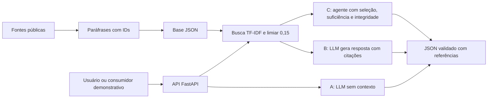

# Quem Faz AI — Relatório final de Generative AI

FIAP — Global Solution 2026.2 · Engenharia de Software, 4º ano · Generative AI for Engineering · Professor Francisco Elanio Bezerra.

**Resumo executivo.** O Quem Faz AI é um assistente local de apoio à contratação, com LLM, recuperação de fontes e API. Três configurações foram comparadas em uma avaliação cega de 20 casos, com revisão humana das 60 respostas: a LLM sem contexto (A) acertou 15% e alucinou em todas as respostas; o RAG simples (B) acertou 70% com 10% de alucinação; o agente (C) acertou 65%, sem alucinações e com todas as respostas sustentadas pelas fontes, mas com 7 recusas indevidas. O sistema não decide contratações nem garante a qualidade de serviços.

## 1. Identificação dos integrantes e RMs

| Integrante | RM |
|---|---|
| Enzo Vazquez Sartorelli | RM94618 |
| Kaue Pastori Teixeira | RM98501 |
| Nicolas Nogueira Boni | RM551965 |
| Guilherme Brazioli | RM98237 |
| Pedro Oliveira Valotto | RM551445 |

## 2. Apresentação do Quem Faz

Quem Faz é uma prova de conceito de plataforma que conecta pessoas e empresas interessadas em serviços a profissionais que procuram oportunidades, inicialmente em São Paulo, SP. O contratante pode explorar categorias ou publicar um pedido para receber propostas. As avaliações devem estar associadas a serviços registrados. O projeto não garante a qualidade do serviço realizado.

## 3. Problema resolvido pela IA

O componente apoia o contratante a identificar informações úteis antes de contratar: o que deve constar em um orçamento, direitos do consumidor e cuidados de segurança, especialmente elétrica. O usuário continua responsável pela escolha. Na configuração recomendada (C), a resposta devolve trechos citados da base e recusa quando não há sustentação; em B, a LLM também reformula a descrição e sugere perguntas. A base não contém preços, prestadores, avaliações individuais, disponibilidade ou certificações pessoais.

## 4. Relação com CitizenTech e segurança

A proposta CitizenTech é apoiar o acesso a informações verificáveis para decisões sobre serviços cotidianos. O eixo de segurança é interpretado nesta solução como segurança na contratação e prevenção de riscos residenciais, especialmente elétricos. Essa interpretação não demonstra que o produto trate de segurança pública em sentido amplo. Não se mediu impacto em usuários reais.

## 5. Ficha técnica

| Elemento | Implementação e limites |
|---|---|
| Público e território | Contratantes e prestadores; São Paulo, SP como território inicial |
| Tarefa | Recuperar orientações sobre contratação, direitos e segurança e responder com referências |
| Plataforma | Python 3.12, FastAPI e Pydantic; execução local |
| Modelo | Qwen 2.5 1.5B via Ollama |
| Base | 15 trechos com identificadores, parafraseados de quatro fontes públicas |
| Avaliação final | 20 casos congelados (14 consta, 6 não consta) × 3 configurações; revisão humana das 60 respostas |
| Integração | API REST local e consumidor demonstrativo |

Avaliação final executada em macOS 27.0.1, Apple M4, 16 GB de RAM, Python 3.12.16 e Ollama 0.40.16. As rodadas históricas foram executadas em Windows 11, AMD Ryzen 5 5600X e 16 GB de RAM. O [manifesto de congelamento](../avaliacao/congelamento_final.json) registra os hashes SHA-256 de `src/core.py`, `src/agente.py`, `src/retrieval.py`, `base/trechos.json` e dos casos. Dependências diretas estão em `requirements.txt`.

## 6. Arquitetura da IA

A envia a pergunta diretamente à LLM. B recupera até três trechos, descarta os que ficam abaixo do limiar e pede à LLM uma resposta em JSON estruturado, citando os IDs; não há verificação posterior das citações. C recupera os mesmos candidatos, inspeciona o contexto contra padrões de instrução suspeita, usa a LLM para selecionar trechos e verificar suficiência, confirma os IDs, verifica a integridade do texto e da URL e devolve o texto exato dos trechos confirmados, com observação quando a cobertura pode ser parcial. O desenho e as ressalvas estão em [arquitetura](arquitetura.md).

## 7. Base de conhecimento e fontes

Os trechos em `base/trechos.json` são paráfrases curtas produzidas para o projeto, não transcrições integrais. Cada registro inclui ID, origem, instituição, URL, data de acesso e demais metadados disponíveis. Condições específicas de licença não foram identificadas; é necessário verificá-las antes de reutilizações além do escopo acadêmico. As URLs retornaram HTTP 200 na verificação registrada em `avaliacao/resultados/fontes_http_v7.json`.

| Fonte pública | Conteúdo | Trechos | Formato | Publicação |
|---|---|---:|---|---|
| [Secretaria Nacional do Consumidor — CDC](https://www.consumidor.gov.br/pages/conteudo/publico/102) | Orçamento, validade e alterações | 4 | HTML | 11/09/1990 |
| [Ministério de Minas e Energia](https://www.gov.br/mme/pt-br/assuntos/secretarias/secretaria-nacional-energia-eletrica/mais-noticias/saiba-como-evitar-acidentes-eletricos-dentro-de-casa/) | Segurança elétrica residencial | 4 | HTML | 31/07/2026 |
| [Procon-SP](https://www.procon.sp.gov.br/codigo/) | Prestação e falhas em serviços | 4 | HTML | Não identificada |
| [IPS-ES](https://www.ips.es.gov.br/detalhe-da-materia/info/37052/choques-eletricos-e-incendios-cuidados-no-trabalho-e-em-casa-podem-evitar-acidentes-graves/) | Riscos elétricos e cuidados | 3 | HTML | Não identificada |

A data de acesso registrada é 17/11/2026. O chunking é curado manualmente: cada paráfrase constitui uma unidade curta de sentido com ID estável e metadados da fonte; não há divisão automática por janela. As paráfrases devem ser conferidas contra as páginas originais antes de conclusões jurídicas ou de segurança.

## 8. Implementação da LLM local

O Ollama fornece a inferência local do Qwen 2.5 1.5B. Foram usados temperatura 0 e semente 42; o limite de geração foi de 450 tokens em A e B e de 120 nas chamadas estruturadas do agente C. A e B usam o recurso de saída estruturada do Ollama (esquema JSON) para reduzir respostas fora do contrato. As três configurações empregam o mesmo modelo-base; não foi realizado LoRA nem fine-tuning.

## 9. Recuperação e métricas

A busca local usa TF-IDF, radicalização em português e equivalências lexicais, com score de cosseno. O limiar 0,15 foi escolhido em calibração anterior (`avaliacao/resultados/v6/calibracao.csv`), com 17/18 acertos binários entre os limiares examinados.

Recall macro@k é a média da proporção de IDs relevantes recuperados no top k em cada pergunta com evidência. Nos 14 casos com evidência da avaliação final, recall macro@1 = 0,786 e recall macro@3 = 1,000, sem aplicar o limiar ([registro por pergunta](../avaliacao/resultados/final/recuperacao.csv)). O trecho correto sempre aparece entre os três primeiros, mas em 4 casos nenhum candidato atinge o limiar, o que causa recusas indevidas em B e C (seção 13).

## 10. RAG simples (B)

B recebe a pergunta, recupera até três trechos, aplica o limiar e envia os trechos aceitos à LLM, que gera descrição, orientações e perguntas com os IDs citados. Se nenhum trecho passa do limiar, B recusa. B apenas normaliza o formato dos IDs; não verifica se a citação sustenta a afirmação. Na avaliação final, 11 respostas tiveram IDs válidos, mas nenhuma reproduziu literalmente o trecho, e a revisão humana encontrou 2 alucinações.

## 11. Especialização por agente (C)

C acrescenta à rotina RAG: inspeção de padrões de instrução suspeita no contexto, seleção de trechos pela LLM, validação dos IDs, verificação de suficiência, confirmação de suporte parcial, verificação de integridade do texto e da URL, rastreio de cada etapa e validação da saída. Como C devolve o texto exato dos trechos confirmados, todas as suas respostas na avaliação final ficaram sustentadas e sem alucinação. São operações de software verificáveis, não treinamento de pesos. Os padrões de detecção não cobrem todos os ataques, e as chamadas de seleção e verificação usam o mesmo modelo, que não é um avaliador independente.

## 12. Avaliação das três configurações

**Método.** Os 20 casos de `avaliacao/casos_cegos_v1.json` (14 com resposta na base e 6 sem) foram congelados por hash junto com o código e a base antes da execução. Cada caso foi enviado às três configurações. As 60 respostas foram avaliadas na interface de revisão cega (ordem embaralhada, configuração oculta) quanto a correção, fundamentação, alucinação e adequação da recusa, com justificativa por item. A revisão foi feita pelo autor e conferida por um segundo revisor.

**Indicadores automáticos** ([placar](../avaliacao/resultados/final/placar.csv)):

| Indicador | A | B | C |
|---|---:|---:|---:|
| JSON final válido | 20/20 | 20/20 | 20/20 |
| Respostas com IDs de fontes válidos | não se aplica | 11/20 | 7/20 |
| Recusas nos 6 casos não consta | 0/6 | 5/6 | 6/6 |
| Recusas nos 14 casos consta | 0/14 | 4/14 | 7/14 |
| Latência média (inclui recusas sem inferência) | 3,417 s | 1,337 s | 0,378 s |

**Revisão humana** ([placar consolidado](../avaliacao/resultados/final/placar_revisao_humana.json)):

| Métrica | A | B | C |
|---|---:|---:|---:|
| Corretas | 3 (15%) | 14 (70%) | 13 (65%) |
| Parciais | 4 | 1 | 0 |
| Incorretas | 13 | 5 | 7 |
| Com alucinação | 20 (100%) | 2 (10%) | 0 (0%) |
| Respostas sustentadas / parciais / não sustentadas | 0 / 0 / 20 | 5 / 5 / 1 | 7 / 0 / 0 |
| Recusas adequadas / indevidas | não se aplica | 5 / 4 | 6 / 7 |

**Análise.** A recuperação é o fator decisivo contra alucinação: A respondeu a tudo, inclusive aos 6 casos sem informação na base, inventando conteúdo. B foi a configuração com mais acertos, mas parte de suas respostas acrescenta informações que os trechos não sustentam. C trocou cobertura por confiabilidade: tudo o que respondeu está sustentado, e todos os seus erros são recusas indevidas. Para orientação de segurança, a recusa indevida é um erro menos grave do que a afirmação não sustentada, por isso C é a configuração recomendada, com a ressalva de reduzir as recusas.

## 13. Análise de cinco erros reais

Erros observados na avaliação final, com evidência no [arquivo de revisão](../avaliacao/resultados/final/revisao_humana.csv).

| # | Caso | Erro | Causa | Correção proposta |
|---|---|---|---|---|
| 1 | B16, A | Pedido de telefone e avaliações de "Maria, pintora cadastrada" (não consta). A inventou uma associação e uma "Casa de Arte Maria". | Sem contexto e sem mecanismo de recusa, o modelo preenche lacunas com conteúdo plausível. | Usar A apenas como referência; em produção, só B ou C, com recusa obrigatória sem evidência. |
| 2 | B07, B | Conteúdo correto sobre mãos úmidas e equipamentos elétricos, mas citando CDC-01 (orçamento). | Só o CDC-01 passou do limiar, por coincidência lexical com "equipamentos"; o trecho certo (MME-03) ficou em 0,135. B não verifica pertinência. | Validar a pertinência das citações (como em C) e melhorar a recuperação. |
| 3 | B05, B | Acrescentou "certificação profissional/treinamento", que o MME-01 não menciona. | Geração livre a partir do trecho, sem verificação textual. | Restringir a resposta ao conteúdo dos trechos ou verificar cada afirmação contra a fonte. |
| 4 | B03, B04, B11, B14 — B e C | Recusa indevida: a resposta estava na base. | Maior score entre 0,05 e 0,12, abaixo do limiar 0,15: o vocabulário da pergunta difere da paráfrase (limite da busca lexical). | Expansão de consulta com sinônimos ou busca semântica (embeddings) e recalibração do limiar. |
| 5 | B05, B06, B07 — C | Recusa indevida em B05 e B06 mesmo com o trecho correto recuperado acima do limiar (MME-01 = 0,289; MME-02 = 0,200). Em B07, a verificação evitou a citação errada do erro 2, mas o trecho certo estava abaixo do limiar. | Verificação de suficiência conservadora, feita pelo mesmo modelo de 1,5B. | Aceitar suporte parcial com observação em vez de recusar e usar um modelo maior para a verificação. |

Os erros históricos das rodadas anteriores e suas reexecuções estão preservados em [comparação dos erros](../avaliacao/comparacao_erros_v8.md).

## 14. Segurança, proteção de dados e limitações

O protótipo não possui autenticação nem controle de exposição e deve ser executado apenas em ambiente local confiável. O filtro de injeção é limitado a padrões e não garante resistência adversarial. Uma consulta `pip-audit`, registrada em `avaliacao/resultados/auditoria_dependencias.json`, não apontou vulnerabilidades conhecidas naquele momento. A configuração A pode produzir fatos falsos ou orientações inseguras. As avaliações usam casos sintéticos, sem dados pessoais reais. O projeto não foi avaliado quanto a todas as obrigações da LGPD.

Limitações da avaliação: os casos foram escritos pela própria equipe e a amostra (20 casos) não permite generalização estatística; a interface cega oculta a configuração, mas ela pode ser inferida pelo estilo da resposta.

## 15. Integração com o Quem Faz

O endpoint `POST /api/ai/assistente` aceita descrição, categoria opcional e configuração A/B/C e retorna resposta estruturada, fontes e rastreio; entrada inválida retorna 422 e falha da LLM local, 503. `exemplos/consumidor.py` demonstra o consumo e `exemplos/verificar_api.py` testa a API por HTTP local. O contrato e o fluxo de uso previsto no produto (assistente na tela de publicação de pedido, com revisão pelo usuário antes de publicar) estão em [integração](integracao_mvp.md).

## 16. Conclusão técnica

A prova de conceito executa inferência local com recuperação de fontes, saídas estruturadas com IDs, API e trilha de experimentos reproduzível. A avaliação cega com revisão humana mostrou que a recuperação reduz a alucinação de 100% (A) para 10% (B) e 0% (C). O agente garantiu fundamentação em todas as respostas, mas recusou 7 dos 14 casos respondíveis, por limite da busca lexical (4) e por verificação de suficiência conservadora (3). Os próximos passos são ampliar a recuperação, flexibilizar a verificação de suficiência, aumentar a amostra de avaliação e implementar autenticação antes de qualquer exposição pública.

## 17. Referências e links de execução

As fontes públicas estão ligadas na seção 7. O [README](../README.md) contém instalação (macOS e Windows), API, testes, interface de revisão e comandos de reprodução. Evidências da avaliação final: [respostas](../avaliacao/resultados/final/geracao.jsonl), [recuperação](../avaliacao/resultados/final/recuperacao.csv), [placar](../avaliacao/resultados/final/placar.csv), [revisão humana](../avaliacao/resultados/final/revisao_humana.csv) e [placar da revisão](../avaliacao/resultados/final/placar_revisao_humana.json). Histórico: [diagnóstico v6](../avaliacao/resultados/diagnostico_v6/diagnostico.md), [auditoria v7](relatorio_auditoria_v7.md), [auditoria de segurança](AUDITORIA_SEGURANCA.md) e [notebooks](../notebooks/).

Repositório GitHub: [https://github.com/guilhermebrazioli/quem-faz-ai](https://github.com/guilhermebrazioli/quem-faz-ai). Vídeo demonstrativo: [inserir URL].

## Adendo: integração com o MVP publicado

Integração com o MVP publicado: `scripts/demo_integracao_mvp.py` lê, somente por GET, as categorias e solicitações do MVP Quem Faz publicado na Azure ([repositório do MVP](https://github.com/guilhermebrazioli/quem-faz)) e envia perguntas de demonstração ao assistente local, associando cada uma a uma categoria real do MVP. A execução registrada em `avaliacao/resultados/integracao_mvp.json` leu 5 categorias (Elétrica, Hidráulica, Limpeza, Montagem de móveis e Pintura) e nenhuma solicitação. Na configuração B, a pergunta associada a Pintura foi fundamentada, com `categoria_sugerida` "Reforma", fora da taxonomia do MVP; a associada a Elétrica retornou `informacao_insuficiente`. Essas saídas não passaram por revisão humana e não integram a avaliação dos 60 casos. A integração não grava dados no MVP, o MVP não exibe as respostas e o assistente roda localmente com Ollama.
