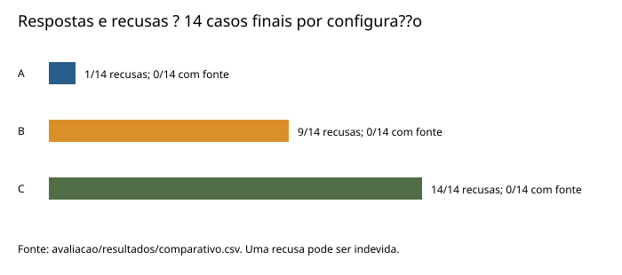

# Relatório técnico: Quem Faz AI

## Identificação e ficha técnica

FIAP, Engenharia de Software, Global Solution 2026.2, disciplina Generative AI for Engineering, professor Francisco Elanio Bezerra. Integrantes e RMs: **não informados**. Quem Faz é uma prova de conceito CitizenTech para conectar contratantes e prestadores em São Paulo. Este componente auxilia a redação do pedido e a contratação informada; a decisão pertence ao usuário e o produto não garante a qualidade dos serviços.

## Arquitetura e implementação

Ver [diagrama e escolhas](arquitetura.md) e [contrato proposto](integracao_mvp.md). A usa apenas a LLM; B consulta a base; C adiciona verificação de IDs e de esquema. C é um fluxo orquestrado, não treinamento: não houve LoRA ou ajuste de pesos. Ollama executou Qwen 2.5 1.5B localmente, com temperatura 0 e semente 42. Python 3.12, FastAPI e Pydantic; quatro testes passaram. Não há código do MVP nesta pasta e a integração real ainda não foi demonstrada.

## Base

Quinze trechos são paráfrases elaboradas para o projeto, não cópias integrais. Metadados completos, links e relação entre ID e fonte estão em `base/trechos.json`; acesso em 17/11/2026. Licenças específicas não identificadas. Versões dos conteúdos podem mudar nas URLs.

| Fonte | Formato | Trechos | Publicação |
|---|---|---:|---|
| Secretaria Nacional do Consumidor, CDC art. 40 | HTML | 4 | 11/09/1990 |
| Ministério de Minas e Energia, segurança elétrica | HTML | 4 | 31/07/2026 |
| Procon-SP, prestação de serviços | HTML | 4 | não identificada |
| IPS-ES, choques elétricos | HTML | 3 | não identificada |

## Avaliação de recuperação

Trinta e dois casos sintéticos: 18 de calibração, 14 finais. O gabarito e partição estão em `avaliacao/casos_teste.json`. Recall@k é a média, sobre perguntas com evidência, da fração de todos os IDs relevantes presentes no top k; casos sem IDs não entram no denominador. Abrangência é a fração de casos cujo escore máximo atinge o limiar; não significa que tenham resposta. Busca lexical TF-IDF cosseno; valores detalhados em `avaliacao/resultados/recuperacao.csv`.

| Partição | Casos com gabarito | Recall@1 | Recall@3 | Cobertura no limiar 0,05 |
|---|---:|---:|---:|---:|
| Calibração | 15 | 0,7333 | 0,8000 | 16/18 |
| Final | 8 | 0,5625 | 0,5625 | 9/14 |

O limiar 0,05 foi selecionado apenas na calibração: 17/18 classificações binárias de existência de resposta, ante 14/18 para 0,10 e 15/18 para 0,12. Isso é uma heurística medida em amostra pequena, não uma garantia; na partição final obteve apenas 9/14 acertos binários. Casos da mesma base são correlacionados e o conjunto não representa a população. O top 3 não recuperou mais gabaritos que o top 1 na avaliação final. A busca falhou em flexões e sinônimos.

## Comparação de geração

Uma execução real em 17/11/2026, mesmos 14 casos finais e modelo nas três configurações. `geracao.jsonl` contém respostas, tempos e rastros, não contém resposta bruta do modelo em erros. Valores reproduzíveis a partir de `python -m avaliacao.consolidar`; tempos incluem recusas sem chamada à LLM.

| Medida | A | B | C |
|---|---:|---:|---:|
| Respostas finais compatíveis com o esquema | 14/14 | 14/14 | 14/14 |
| Chamadas efetivas à LLM | 14 | 9 | 9 |
| Falhas de parsing **ou** validação da saída da LLM | 1/14 | 4/9 | 2/9 |
| Recusas totais | 1/14 | 9/14 | 14/14 |
| Recusas nos casos rotulados não consta | 0/6 | 4/6 | 6/6 |
| Respostas com ao menos uma fonte listada | 0/14 | 0/14 | 0/14 |
| Latência média em segundos | 1,715 | 0,988 | 1,025 |

Todas as respostas finais têm esquema válido porque o sistema substitui erros por recusa; isso não demonstra que todas as saídas brutas eram JSON válido. O código não guarda o texto bruto em caso de erro, portanto não distingue JSON sintaticamente inválido de esquema inválido. B classificou cinco respostas como fundamentadas sem listar fonte: o rótulo não é evidência de fundamentação. C recusou sete respostas por citações ausentes ou inválidas e recusou **todas** as perguntas, inclusive as respondíveis. Portanto, não foi demonstrada melhoria de qualidade com RAG ou agente: C melhorou a recusa nos casos rotulados como não consta ao custo de nenhuma resposta útil nesta amostra. Latências de recusas não são comparáveis a inferências completas.

Correção geral, suporte semântico das citações, taxa de respostas sem fundamentação e taxa de alucinação ainda não foram medidas de maneira abrangente. Sugestão operacional para avaliação futura: alucinação = proporção de respostas que afirmam ao menos um fato não sustentado ou contrário às evidências, revisadas por avaliador humano independente; separar omissões e recusas indevidas. Não se deve substituir essa revisão por mera existência de ID.

## Cinco erros e auditoria

Os cinco casos com respostas completas, causas e propostas constam em [erros reais](../avaliacao/erros_reais.md). O ensaio revelou alucinação na referência, recuperação ausente e respostas sem fonte. Correções ainda não foram testadas.

| Critério | Estado |
|---|---|
| Tarefa e gabarito, inclusive não consta | implementados; casos sintéticos |
| Base segmentada com fontes | implementada; 15 paráfrases |
| Recall e limiar | medidos; limiar apenas heurístico |
| Geração fundamentada e recusa | parcial: B não exige citação; C recusou todas; sem validação semântica |
| Agente comparado a RAG | implementado e executado; utilidade não demonstrada |
| Placar das três configurações | medido parcialmente; métricas humanas pendentes |
| Cinco erros reais | registrados; propostas não retestadas |
| README e reprodutibilidade | documentados; integração real e execução independente ainda pendentes |

## Limitações e conclusão

Nenhum teste formal de injeção de prompt foi executado. As instruções colocam os trechos como dados, mas não é possível garantir resistência a ataques. Não há autenticação nem proteção de dados para publicação; a API é local e experimental. A base não cobre preços, profissionais ou certificações individuais. Um modelo pequeno pode errar e recomendar intervenções inseguras, inclusive na configuração A. Não usar em produção nem para situações de risco. Para avançar, melhorar busca e formato de citações, avaliar segurança e suporte por revisão independente, executar novamente todos os casos e integrar ao MVP real. Link do repositório e vídeo: não informados.

Visualização das recusas e presença de fontes: 
