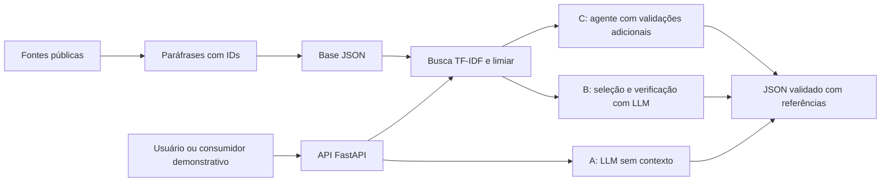

# Quem Faz AI — Relatório final de Generative AI

FIAP — Global Solution 2026.2 · Engenharia de Software, 4º ano · Generative AI for Engineering · Professor Francisco Elanio Bezerra.

**Resumo executivo.** O Quem Faz AI é um assistente local de apoio à contratação, com LLM, recuperação de fontes e API. A avaliação automática demonstra execução e rastreabilidade, mas a amostra é pequena, as recusas indevidas persistem e a revisão semântica humana independente ainda não foi realizada. O sistema não decide contratações nem garante qualidade de serviços.

## 1. Identificação dos integrantes e RMs

| Integrante | RM |
|---|---|
| Enzo Vazquez Sartorelli | RM94618 |
| Kaue Pastori Teixeira | RM98501 |
| Nicolas Nogueira Boni | RM551965 |
| Guilherme Brazioli | RM98237 |
| Pedro Oliveira Valotto | RM551445 |

## 2. Apresentação do Quem Faz

Quem Faz é uma prova de conceito de plataforma que conecta pessoas e empresas interessadas em serviços a profissionais que procuram oportunidades, inicialmente em São Paulo, SP. O contratante pode explorar categorias ou publicar um pedido para receber propostas. As avaliações devem estar associadas a serviços registrados. O projeto não garante a qualidade do serviço realizado.

## 3. Problema resolvido pela IA

O componente procura apoiar a descrição de necessidades, a identificação de informações úteis para contratação e o acesso a orientações de segurança e direitos do consumidor. O usuário continua responsável pela escolha. Na implementação avaliada, a resposta com contexto devolve trechos citados e preserva a descrição de entrada; a reformulação automática da descrição e a geração de perguntas úteis não estão concluídas. A base não contém preços, prestadores, avaliações individuais, disponibilidade ou certificações pessoais.

## 4. Relação com CitizenTech e segurança

A proposta CitizenTech é apoiar acesso a informações verificáveis para decisões sobre serviços cotidianos. O eixo de segurança é interpretado nesta solução como segurança na contratação e prevenção de riscos residenciais, especialmente elétricos. Essa interpretação não demonstra que o produto trate de segurança pública em sentido amplo nem substitui eventual definição específica do enunciado institucional. Não se demonstrou impacto em usuários reais.

## 5. Ficha técnica

| Elemento | Implementação e limites |
|---|---|
| Público e território | Contratantes e prestadores; São Paulo, SP como território inicial |
| Tarefa | Recuperar orientações sobre contratação, direitos e segurança e responder com referências |
| Plataforma | Python 3.12.10, FastAPI e Pydantic; execução local em Windows 11 |
| Modelo | Qwen 2.5 1.5B, quantização Q4_K_M, Ollama 0.40.16 |
| Base | 15 trechos com identificadores, parafraseados de quatro fontes públicas |
| Avaliação | 32 casos anteriores e 20 novas perguntas sintéticas; revisão semântica humana pendente |
| Integração | API local e consumidor demonstrativo; MVP principal não disponível |

A máquina usada tinha 16 GB de RAM e processador AMD Ryzen 5 5600X. O modelo local tem digest `65ec06548149b04c096a120e4a6da9d4017ea809c91734ea5631e89f96ddc57b`. O [manifesto de experimentos](manifesto_atual_v9.json) registra informações de ambiente, arquivos, hashes e datas de modificação; essas datas são vestígios do sistema, não uma prova independente do instante de inferência. Dependências diretas estão em `requirements.txt`; a [captura do ambiente](dependencias_ambiente.txt) antecede a instalação do utilitário de auditoria `pip-audit`.

## 6. Arquitetura da IA

B e C recuperam candidatos, aplicam uma detecção limitada de instruções suspeitas e utilizam a LLM para selecionar trechos e avaliar a pertinência. Se a verificação inicial falha, uma segunda seleção pode confirmar IDs para uma resposta parcial. O programa apresenta textos exatos dos trechos internos com seus IDs e uma observação de possível cobertura parcial. C acrescenta verificação de integridade do texto e da URL. O desenho e as ressalvas estão em [arquitetura](arquitetura.md).

## 7. Base de conhecimento e fontes

Os trechos em `base/trechos.json` são paráfrases curtas produzidas para o projeto, não transcrições integrais. Cada registro inclui ID, origem, instituição, URL, data de acesso e demais metadados disponíveis. Condições específicas de licença não foram identificadas; é necessário verificá-las antes de reutilizações além do escopo acadêmico. As URLs retornaram HTTP 200 na verificação registrada em `avaliacao/resultados/fontes_http_v7.json`; disponibilidade da página não verifica automaticamente a correção de cada paráfrase.

| Fonte pública | Conteúdo | Trechos | Formato | Publicação |
|---|---|---:|---|---|
| [Secretaria Nacional do Consumidor — CDC](https://www.consumidor.gov.br/pages/conteudo/publico/102) | Orçamento, validade e alterações | 4 | HTML | 11/09/1990 |
| [Ministério de Minas e Energia](https://www.gov.br/mme/pt-br/assuntos/secretarias/secretaria-nacional-energia-eletrica/mais-noticias/saiba-como-evitar-acidentes-eletricos-dentro-de-casa/) | Segurança elétrica residencial | 4 | HTML | 31/07/2026 |
| [Procon-SP](https://www.procon.sp.gov.br/codigo/) | Prestação e falhas em serviços | 4 | HTML | Não identificada |
| [IPS-ES](https://www.ips.es.gov.br/detalhe-da-materia/info/37052/choques-eletricos-e-incendios-cuidados-no-trabalho-e-em-casa-podem-evitar-acidentes-graves/) | Riscos elétricos e cuidados | 3 | HTML | Não identificada |

A data de acesso registrada é 17/11/2026. O trabalho mantém conteúdo sintético de avaliação; não usa cadastros reais de prestadores.

O chunking é curado manualmente: cada uma das 15 paráfrases constitui uma unidade curta de sentido com ID estável e metadados da fonte; não há divisão automática por tamanho de janela. As paráfrases devem ser conferidas contra as páginas originais antes de conclusões jurídicas ou de segurança.

## 8. Implementação da LLM local

O Ollama fornece a inferência local do Qwen 2.5 1.5B. Foram usados temperatura 0 e semente 42; o limite de geração foi 450 tokens para A e 120 nas chamadas estruturadas de B e C. As configurações empregam o mesmo modelo-base. Execução local, RAG e orquestração não implicam ajuste dos pesos: não foi realizado LoRA nem fine-tuning. O código congelado e a base avaliados na segunda rodada têm hashes em `avaliacao/congelamento_cega_v2.json`.

## 9. Recuperação e métricas

A busca local usa TF-IDF, radicalização em português e equivalências lexicais, com score de cosseno. O limiar 0,15 foi escolhido em calibração anterior com 17/18 acertos binários entre os limiares examinados. A calibragem e a base pequenas não garantem suficiência da evidência. As equivalências foram influenciadas pelos erros de uma avaliação anterior, portanto aquela avaliação deixou de ser independente.

Recall macro@k é a média da proporção de IDs relevantes recuperados no top k em cada pergunta com evidência; hit@k mede se pelo menos um ID relevante aparece. Na amostra de 20 perguntas, 14 tinham um ID relevante cada: recall macro@1 = 0,7857 e recall macro@3 = 1,0000, sem aplicar o limiar. Na avaliação anterior reutilizada, foram 0,8125 e 0,8125; na execução inicial, 0,5625 e 0,5625. Busca não é utilizada por A. Registros por pergunta: `avaliacao/resultados/cega_v2/recuperacao.csv` e `avaliacao/resultados/v6/calibracao.csv`.

## 10. RAG simples

B recebe a pergunta, busca até três trechos, aplica o limiar, solicita seleção de IDs à LLM e verifica se os IDs selecionados são válidos. A resposta apoiada usa o texto exato dos trechos internos selecionados. Quando não há evidência ou a verificação falha, a configuração recusa. A LLM também é usada para avaliar pertinência, mas pode errar. A existência de uma referência estrutural não demonstra que ela sustente a resposta à pergunta.

## 11. Especialização por agente

C acrescenta à rotina RAG verificação de integridade do texto e da URL, rastreio e validação de saída. A inspeção limitada de padrões de instrução suspeita foi estendida a B e C após a primeira rodada adicional, pois B enviava o contexto sem essa inspeção. O código anterior está em `avaliacao/snapshots/v8/agente.py`; os resultados originais foram preservados. São operações de software verificáveis, não treinamento de pesos. Os padrões de detecção não cobrem todos os ataques, e as chamadas de seleção e confirmação usam o mesmo modelo; não são avaliadores independentes. O placar não demonstrou que C supera B.

## 12. Avaliação das três configurações

As 20 perguntas novas foram elaboradas pela mesma equipe e congeladas antes da primeira execução, mas não constituem validação independente de autoria ou de gabarito. Após a primeira rodada, detectou-se uma falha de codificação do prompt de confirmação. Os dados daquela rodada foram preservados; corrigiu-se a codificação e as mesmas perguntas foram repetidas. A tabela a seguir descreve **a repetição**, não uma segunda amostra cega. Nenhum ajuste adicional do algoritmo foi realizado a partir desses resultados.

| Indicador automático | A: sem contexto | B: RAG | C: agente |
|---|---:|---:|---:|
| Perguntas | 20 | 20 | 20 |
| JSON final validado | 20/20 | 20/20 | 20/20 |
| Respostas com IDs existentes e texto igual ao trecho interno | 0/20 | 7/20 | 7/20 |
| Recusas nos seis casos rotulados não consta | 1/6 | 6/6 | 6/6 |
| Recusas nos 14 casos rotulados consta | 2/14 | 7/14 | 7/14 |
| Latência média, incluindo recusas sem inferência | 1,539 s | 0,464 s | 0,439 s |

O JSON final pode ser uma recusa substitutiva; não é medição da validade do JSON bruto do modelo. As contagens de recusa são classificações automáticas pelo rótulo do gabarito, não avaliações humanas de sua adequação. Correção das respostas, fundamentação semântica e taxa de alucinação **não foram medidas por revisão humana**. O tempo médio inclui casos sem chamada à LLM e não deve ser interpretado como comparação de custos de inferência equivalentes. A geração da amostra é reproduzível pelos comandos do README, mas variações de hardware e execução podem alterar tempos e saídas.

Na verificação final foram aprovados 24 testes automatizados; houve um aviso de descontinuação da integração do cliente de testes Starlette com `httpx`. O fluxo real do cliente demonstrativo até a API e a LLM foi executado; registro em `avaliacao/resultados/integracao_cliente_v9.json`. A interface de revisão foi testada nas 60 respostas, mas nenhum campo de julgamento humano foi preenchido.

As sete recusas de C em casos rotulados respondíveis estão documentadas em [investigação das recusas](../avaliacao/investigacao_sete_recusas.md). As evidências esperadas apareceram no top 3, mas várias ficaram abaixo do limiar. Em duas, trechos relevantes foram selecionados e depois rejeitados pela verificação. O experimento não guardou todas as respostas brutas e não permite afirmar com certeza que uma resposta completa válida foi rejeitada. Algumas formulações de gabarito dependem de interpretação e carecem de revisão humana.

### Avaliação adicional interna

Após congelar o código e [16 novos casos sintéticos](../avaliacao/casos_internos_adicionais.json), foi executada uma rodada adicional, sem ajuste do algoritmo pelos seus resultados. Os casos foram formulados no próprio projeto a partir da mesma base; não são uma amostra independente de autoria. Sobre os dez casos com IDs de referência, recall macro@1 foi 0,9 e recall macro@3 foi 1,0, sem aplicar limiar. A obteve 16 JSON finais válidos, uma recusa entre seis casos não consta e três entre dez casos consta; latência média de 1,793 s. B e C obtiveram, cada um, 16 JSON válidos, quatro respostas com IDs verificados, seis recusas entre seis não consta e seis recusas entre dez consta; latências médias de 0,445 s e 0,434 s. [Placar](../avaliacao/resultados/adicional_v1/placar.csv) e [respostas](../avaliacao/resultados/adicional_v1/geracao.jsonl) apresentam os dados. Recusas são comparadas aos rótulos, não julgadas automaticamente corretas. B e C empataram nos indicadores listados; a utilidade semântica segue sem revisão humana.

A [pré-revisão automática](../avaliacao/resultados/cega_v2/pre_revisao_automatica.jsonl) reúne as 60 respostas da rodada anterior, seus gabaritos, trechos recuperados e verificações estruturais. Ela não avalia significado, correção factual nem alucinação e não preenche avaliações humanas.

Foi também executado um [juiz automático](../avaliacao/resultados/cega_v2/pre_revisao_modelo.jsonl) sobre as mesmas 60 respostas, utilizando a mesma família e tamanho de LLM. A avaliação não é humana nem independente e recebeu gabarito e trechos recuperados. Treze saídas não passaram pelo esquema. Entre as saídas válidas referentes a recusas, o juiz classificou a adequação como “não aplicável” em 22 de 22 casos; essa inconsistência torna suas contagens inadequadas como métricas confiáveis de qualidade. Os resultados brutos e o [resumo](../avaliacao/resultados/cega_v2/resumo_pre_revisao_modelo.json) foram preservados para inspeção. Eles não substituem revisão humana nem estabelecem taxa de alucinação.

Uma correção posterior estendeu a B a inspeção de padrões suspeitos, identificada na auditoria estática e não nos resultados da amostra. Após a mudança, os mesmos 16 casos foram repetidos em `avaliacao/resultados/adicional_v2/`; esta repetição é exploratória, não uma amostra nova. B e C mantiveram quatro respostas com IDs verificados, seis recusas nos dez casos consta e seis nos seis não consta, com médias de 0,492 s e 0,473 s. A teve uma recusa entre seis não consta e três entre dez consta, média de 1,762 s; as 16 respostas finais por configuração tiveram JSON válido. O código atual e os dados dessa repetição estão identificados por `avaliacao/congelamento_adicional_v2.json`.

### Auditoria dos critérios da disciplina

| Critério | Máximo | Evidência e experimento | Situação | Pendência |
|---|---:|---|---|---|
| Tarefa e casos com gabarito, inclusive não consta | 0,5 | `avaliacao/casos_teste.json`; `avaliacao/casos_cegos_v1.json` | Parcial | Revisar gabaritos e ambiguidades por pessoa independente |
| Base segmentada e fontes | 1,0 | `base/trechos.json`; verificação HTTP | Concluído | Revisar condições de uso e ampliar cobertura quando necessário |
| Busca, recall@1 e recall@3, limiar | 1,0 | `avaliacao/resultados/cega_v2/recuperacao.csv`; `avaliacao/resultados/v6/calibracao.csv` | Concluído | Amostra maior e anotação independente |
| JSON, fontes e recusa fundamentada | 2,0 | `src/agente.py`; `avaliacao/resultados/cega_v2/geracao.jsonl`; testes | Parcial | Avaliação semântica, segurança e redução de recusas indevidas |
| Agente comparado ao RAG | 2,0 | `src/agente.py`; `avaliacao/resultados/cega_v2/placar.csv` | Parcial | Benefício do agente não demonstrado |
| Placar de três configurações | 2,0 | `avaliacao/resultados/cega_v2/placar.csv` | Parcial | Completar correção, fundamentação e alucinação revisadas |
| Cinco erros reais e correções | 1,0 | `avaliacao/comparacao_erros_v8.md` | Concluído | Falhas remanescentes documentadas |
| README e reprodutibilidade | 0,5 | `README.md`, `requirements.txt`, oito notebooks executados | Parcial | Validação de reprodução independente |

Não se atribui nota oficial. Os testes automatizados não substituem a revisão da rubrica pelo professor.

## 13. Análise dos cinco erros reais

Os erros históricos incluem resposta sem contexto sobre validade do orçamento, recusa em tomada quente, recusa sobre itens do orçamento, resposta fora do domínio sobre a Copa e resposta RAG sem citação para pergunta sobre garantia. Os resultados originais e reexecuções, com saídas completas, constam em [comparação dos erros](../avaliacao/comparacao_erros_v8.md). T17 passou a citar o trecho IPS-01; a referência A ainda alucinou no caso T28. Propostas de correção e limitações estão documentadas, sem reescrever os registros anteriores.

## 14. Segurança, proteção de dados e limitações

O protótipo não possui autenticação nem controle de exposição e deve ser executado apenas em ambiente local confiável. O filtro de injeção é limitado a padrões e não garante resistência adversarial; não há auditoria de segurança abrangente. Uma consulta `pip-audit` das dependências diretas e transitivas, registrada em `avaliacao/resultados/auditoria_dependencias.json`, não apontou vulnerabilidades conhecidas naquele momento; isso não garante ausência de falhas. A configuração A pode produzir fatos falsos ou orientações inseguras. As avaliações usam casos sintéticos; a aplicação não precisa registrar dados pessoais reais nas experiências. O projeto não foi avaliado quanto a todas as obrigações legais da LGPD. A revisão humana proposta deve evitar a inclusão de dados pessoais desnecessários.

## 15. Integração demonstrativa com o Quem Faz

O endpoint `POST /api/ai/assistente` aceita descrição, categoria opcional e configuração A/B/C, retornando resposta estruturada, fontes e rastreio. `exemplos/consumidor.py` demonstra consumo e `exemplos/verificar_api.py` testa HTTP local. Não houve comunicação testada com o MVP principal; o contrato proposto e suas limitações estão em [integração](integracao_mvp.md).

## 16. Conclusão técnica

A prova de conceito executa inferência local e disponibiliza recuperação, saídas com IDs de fontes, API e trilha de experimentos. A recuperação atingiu recall macro@3 de 1,0 na amostra sintética de 14 casos com evidência, sem aplicação do limiar, mas metade desses casos foi recusada pelo agente na repetição com o prompt corrigido. A comparação não demonstra superioridade do agente sobre o RAG, nem validação semântica das respostas. Para uma conclusão confiável são necessárias revisão humana independente, gabaritos e amostra maiores, avaliação de segurança e integração real. O componente ainda não deve ser considerado finalizado para produção ou como evidência integral de todos os critérios.

## 17. Referências e links de execução

As fontes públicas estão ligadas na seção 7. [README](../README.md) contém instalação, API, testes, interface de revisão e comandos de reprodução. No Windows, crie o ambiente com `py -3.12 -m venv .venv`, instale `requirements.txt`, inicie o Ollama com `qwen2.5:1.5b`, execute `python -m uvicorn src.api:app` e valide com `python -m pytest -q`. A avaliação adicional pode ser repetida com `python -m avaliacao.executar_adicional --destino avaliacao/resultados/minha_amostra_adicional`, usando uma pasta nova; a repetição usa o mesmo conjunto já observado e não é cega.

Evidências: [placar da repetição](../avaliacao/resultados/cega_v2/placar.csv), [respostas completas](../avaliacao/resultados/cega_v2/geracao.jsonl), [diagnóstico v6](../avaliacao/resultados/diagnostico_v6/diagnostico.md), [auditoria histórica](relatorio_auditoria_v7.md), [auditoria de segurança](AUDITORIA_SEGURANCA.md) e [notebooks](../notebooks/). URL do repositório e vídeo demonstrativo: não informados.
