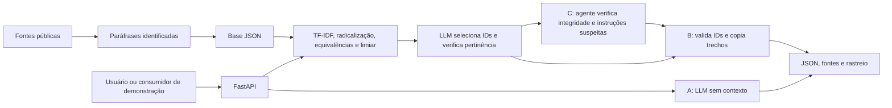

# Arquitetura implementada

O modelo Qwen local atua na seleção e na verificação da relevância. A saída com contexto usa o texto idêntico ao trecho curado para impedir que uma paráfrase do modelo seja tratada como comprovada. Isso não garante que o trecho responda à pergunta, nem que a fonte original esteja correta. C é um fluxo orquestrado com ferramentas verificáveis, não treinamento ou agente autônomo geral; nenhum peso foi treinado. A detecção de instruções suspeitas é uma lista limitada de padrões. Descrição não é aprimorada e perguntas não são geradas na implementação atual.

Atualização v7: quando a verificação de suficiência é negativa, uma segunda seleção da mesma LLM pode confirmar parte dos IDs já selecionados; a resposta preserva os trechos exatos e avisa que pode ser parcial. Para C, candidatos são examinados por padrões limitados de injeção antes da chamada à LLM. Não se trata de validação semântica independente. Resultados em `docs/relatorio_auditoria_v7.md`.

Atualização de segurança: B e C aplicam agora a detecção limitada de padrões suspeitos ao contexto antes da chamada à LLM. C mantém validações adicionais de integridade e URL. Esta proteção é incompleta e não substitui uma avaliação adversarial abrangente. A rodada anterior à alteração e a repetição exploratória estão preservadas.
